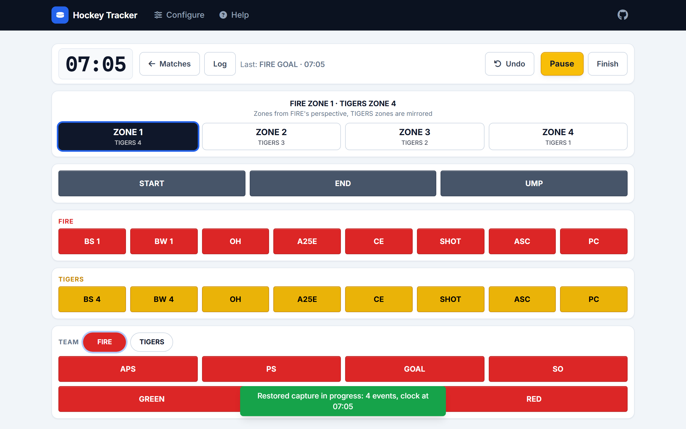
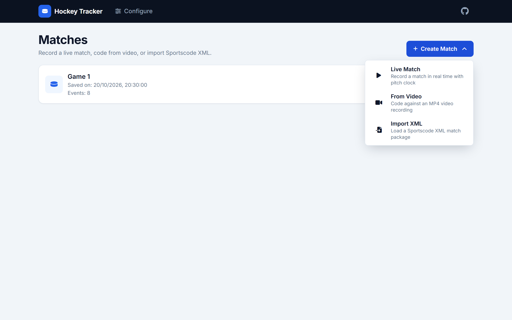
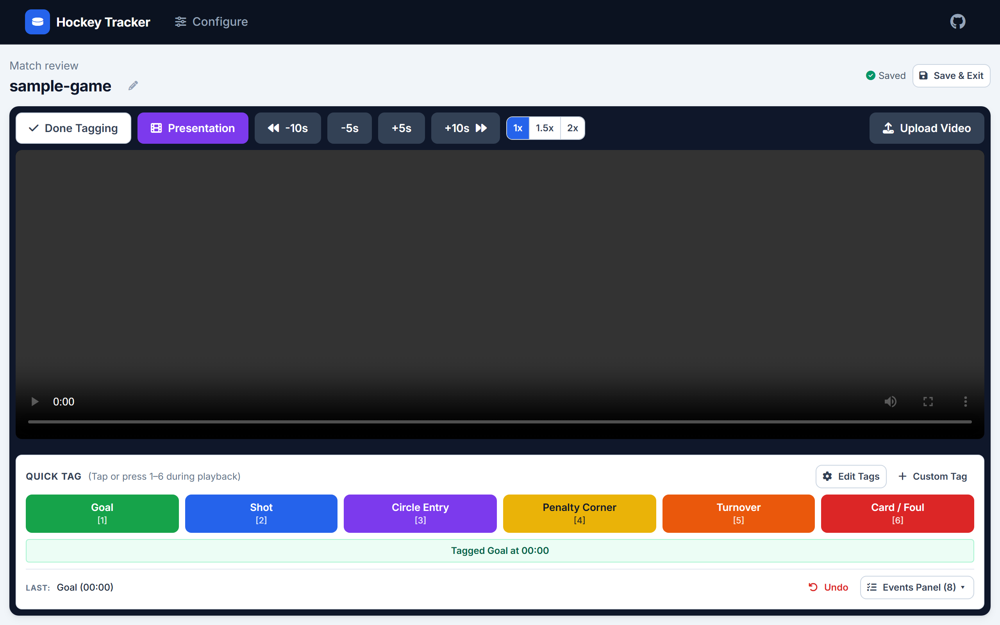
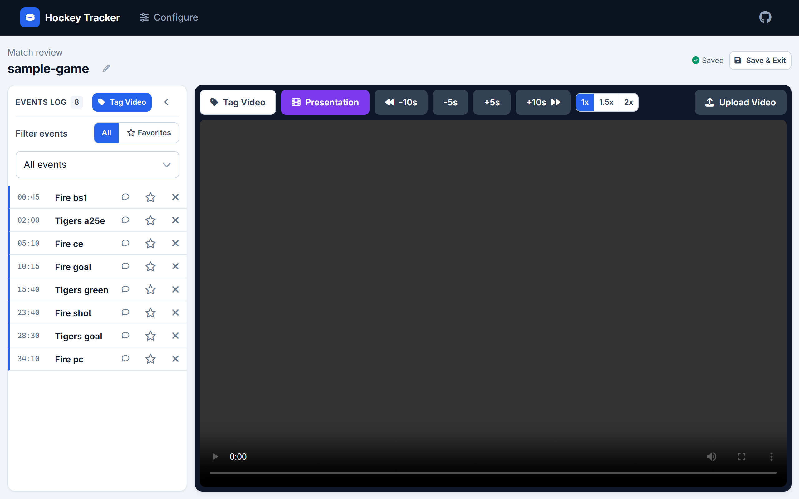

# simple-coding

[](https://github.com/dneimke/simple-coding/actions/workflows/static.yml)
[](coverage/lcov-report/index.html)
[](https://www.ecma-international.org/ecma-262/6.0/)
[](https://opensource.org/licenses/MIT)

Field hockey match coding and review in one browser app. Log the game on the sideline or from an MP4, keep a lead/lag window on every event, and present the clips without an NLE or a render queue. Games stay in the browser.

The full product test for what we build next is [Core Friction Points & Product Intent](docs/core-friction-points.md).



## Run it

You need [Node.js 20](https://nodejs.org/) or newer. Open this folder in Cursor or VS Code.

```bash
git clone https://github.com/dneimke/simple-coding.git
cd simple-coding
npm install
```

Press **F5**.

The **simple-coding** launch config starts the server, attaches the browser debugger, and opens Matches with the sample match already listed (8 events, FIRE and TIGERS). Breakpoints in `src/` bind to the page. The server uses port 3000 and moves to the next free port if 3000 is taken. F5 follows the port it prints.

| Launch config | What opens |
| :--- | :--- |
| **simple-coding** | Matches, with the sample game. This is F5. |
| **simple-coding (Edge)** | The same page in Edge, when Chrome is not installed. |
| **Live capture** | The event board, clock at 07:05, four events already logged. |
| **Match review** | The sample timeline, favorites, and video player. |
| **Jest: current file** | The test file you have open, under the debugger. |

From a terminal, `npm start` prints those same URLs and opens Matches. `BROWSER=none npm start` leaves the browser alone (F5 sets this).

```bash
npm test
npm run test:watch
npm run test:coverage
```

| Screen | URL once the server is up |
| :--- | :--- |
| Matches, sample game | `http://localhost:3000/index.html#saved-games?mock=sample` |
| Live capture, in progress | `http://localhost:3000/index.html#event-capture?mock=active` |
| Match review | `http://localhost:3000/timeline-video.html?game=sample-game` |
| Continue coding | `http://localhost:3000/timeline-video.html?game=sample-game&mode=tag` |
| In-app guide | `http://localhost:3000/index.html#help` |

## The three problems

Coaches currently split one match across Sportscode, a video editor, a spreadsheet, and a lot of scrubbing. simple-coding exists to take those three costs out of the week.

### 1. Game setup divergence

Setting up two teams, then taking a different path for a live sideline game than for an MP4, burns the minutes before pushback.

Today, every match starts from **+ Create Match** on the Matches screen. The same hub offers three starts, and each one sets the clock for the way you are working:

- **Live Match** is the pitch stopwatch. Tap Start on the whistle. Team-coloured buttons stay put, sticky zones `1`–`4` ride along with each tap, and the top bar shows `Last: <Event> · mm:ss` so a glance confirms the code. Undo is one tap, or Ctrl+Z.
- **From Video** has no separate stopwatch. Scrub or pause at `14:20`, tap a code, and the event is stored at `14:20` with that button's lead and lag. Playback runs at `1.5x` or `2x`, with `-5s` / `+5s` / `+10s` to skip stoppages.
- **Import XML** turns a Sportscode or MyVA file into a saved match. Each instance keeps its start and end, so a click seeks to the build-up of the play.



Product goal: teams are defined once and chosen from a short list, and one clock engine accepts either the match stopwatch or `video.currentTime` without a different workflow. See [Friction 1](docs/core-friction-points.md#friction-1-game-setup-divergence-live-vs-video-and-new-teams).

### 2. The two-pass coding slog

Coding at `2x` can turn 80 minutes of video into about 40. A required second pass for zones, where the ball came from, and tactical modifiers puts another 15 minutes on the end and stalls review.

Today the first pass already carries the spatial code, and the second pass is a short sweep instead of a re-watch:

- On the sideline, tap a zone once as the ball changes quarter. Later buttons inherit it (`FIRE BS2`) without a second tap per event.
- From video, the Quick Tag bar sits under the player. Tags save as you go. **Continue coding** on any saved match opens that same timeline at `1x`, `1.5x`, or `2x` so a coach tag (`Press`, `Outlet`, `Turnover`) lands on the events you already have.
- In Match Review, **Sweep** jumps about 3 seconds before each unlabelled clip. Keys `1`–`3` assign the pill (Left, Center, Right), Space skips, and the next clip loads immediately. Twenty circle entries can be flanked in about a minute. Possession origin is derived: a Ball Won within 10 seconds marks the entry as a counter-attack; otherwise it is settled build-up. You do not tap a separate origin button.



Product goal: the modifier is part of the first tag. Tap `C` for Circle Entry and a short overlay offers Left, Center, or Right before the moment is gone, and state memory fills the modifiers that follow from the code you just logged. See [Friction 2](docs/core-friction-points.md#friction-2-the-two-pass-coding-slog-event-logging-plus-secondary-labeling).

### 3. Post-match clip assembly

After the codes exist, scrubbing in and out points and rendering slices for the coach meeting takes about 45 minutes.

Today the clip window is decided when the button is designed, and review plays those windows in the browser:

- Each button has a **pre-roll lead** and a **post-roll lag**. A shot can start 15 seconds before the tap so the carry into the circle is in the clip. A penalty corner can run 10 seconds after the tap so the injection and the outcome stay in frame.
- Match Review filters by code (`PC`, `Circle Entry`, `Shot`), and seeking lands at the start of the play (`time - lead`), not on the tap itself.
- Star the 6–10 teaching moments and step through them in **Presentation Mode**. The browser player seeks from window to window. Nothing is rendered out to a file.
- **Export XML** is there when the film still has to go to MyVA or Hudl Sportscode. The file is Sportscode XML (`<ALL_INSTANCES>` and `<ROWS>`), and labels travel in `<label>` tags. Lead and lag are the instance start and end.



Product goal: presentation stays a browser playlist of those pre-sized windows, including starred and filtered sets, with no export step required to run the meeting. See [Friction 3](docs/core-friction-points.md#friction-3-post-match-clip-sizing-and-assembly-overhead-the-45-minute-bottleneck).

The in-app guide (`#help`) walks the same three starts, board customizer, and label sweep with the screens above.

## Documentation

- [Core Friction Points & Product Intent](docs/core-friction-points.md) — the three bottlenecks every change has to reduce
- [Agent Context & Product Rules](AGENTS.md) — product gate, personas, journeys, and quality bars
- [Design Language](docs/design-language.md) — tokens, semantic classes, and layout rules
- [MyVA Lead & Lag Timings](docs/myva-lead-lag-times.md) — clip windows for Sportscode XML export

## License

MIT. See [LICENSE](LICENSE).
